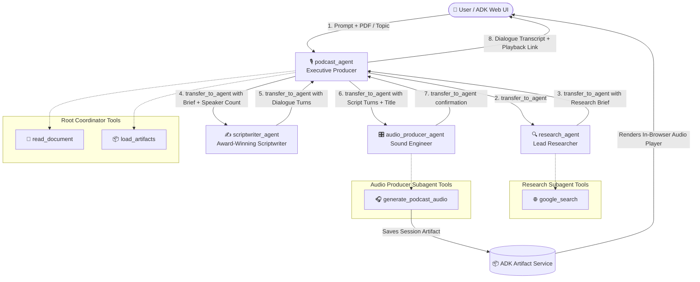
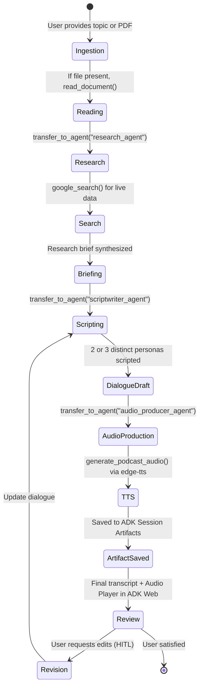

# 🎙️ Podcast Agent: Complete Architecture & Audio Generation Guide

This document provides a comprehensive technical breakdown of the **Podcast Agent** built with the **Google Agent Development Kit (ADK)**. It covers the multi-agent orchestration architecture, tool boundaries, and an in-depth explanation of how multi-speaker neural audio is generated and rendered in the browser.

---

## 1. System Architecture

The Podcast Agent is built on Google ADK's **Collaborative Multi-Agent Hierarchy**. Rather than having a monolithic agent handle every task, the system separates responsibilities across a root coordinator and three specialized subagents:



### Component Roles & Tool Boundaries

| Agent | Role | Tools Assigned | Responsibility |
| :--- | :--- | :--- | :--- |
| **`podcast_agent`** | Root Coordinator & Executive Producer | `read_document`, `load_artifacts` | Ingests user input/files, enforces the strict sequential pipeline, presents transcripts, and manages Human-in-the-Loop (HITL) feedback. |
| **`research_agent`** | Investigative Researcher | `google_search` | Researches live real-world statistics, trends, counter-arguments, and case studies to ground the episode. |
| **`scriptwriter_agent`** | Spoken Dialogue Writer | *(None - Pure LLM)* | Crafts realistic, engaging dialogue for 2 or 3 distinct personas (Alex, Morgan, Taylor). |
| **`audio_producer_agent`** | Sound Engineer & Synthesizer | `generate_podcast_audio` | Synthesizes distinct neural voices for each turn, stitches the master MP3, and saves it as an ADK Session Artifact. |

---

## 2. In-Depth: How Audio Generation Works

A common point of confusion is how the text written by the LLM is transformed into a playable multi-speaker `.mp3` file, and how that audio appears directly inside the ADK Web UI.

### The Underlying Technology: `edge-tts` (Microsoft Neural TTS)

Instead of relying on expensive third-party paid voice APIs or requiring external API keys, the agent uses the **`edge-tts`** Python library.

* **What it is**: `edge-tts` communicates with Microsoft's neural text-to-speech service over secure WebSockets.
* **Cost & Quota**: **$0 extra cost**, no API key required, and zero external subscriptions.
* **Quality**: True high-fidelity neural voices with natural inflection, breathing rhythms, and realistic conversational prosody.

---

### Voice Personas & Casting

Each speaker persona defined by the scriptwriter is mapped to a dedicated neural voice model:

| Speaker | Character Persona | Assigned Neural Voice | Accent / Voice Profile |
| :--- | :--- | :--- | :--- |
| **Alex** | Host & Moderator | `en-US-GuyNeural` | Energetic, warm, charismatic American male voice |
| **Morgan** | Domain Expert | `en-US-JennyNeural` | Articulate, knowledgeable, approachable American female voice |
| **Taylor** | Skeptic / 3rd Host | `en-GB-RyanNeural` | Sharp, expressive, engaging British male voice |
| *Fallback* | Any other custom name | `FALLBACK_VOICE_POOL` | Dynamic rotation across high-quality regional neural voices |

---

### The Audio Generation Pipeline: Step-by-Step

The following sequence diagram illustrates the entire audio synthesis lifecycle from the moment `audio_producer_agent` receives the script turns:

```mermaid
sequenceDiagram
    autonumber
    participant AP as 🎛️ audio_producer_agent
    participant Tool as 🛠️ generate_podcast_audio
    participant Edge as ☁️ edge-tts WebSocket
    participant Disk as 💾 Local Filesystem (output/)
    participant Artifact as 📦 ADK ArtifactService
    participant WebUI as 🖥️ ADK Web UI (Browser)

    AP->>Tool: Call generate_podcast_audio(script_data, output_filename)
    
    rect rgb(30, 40, 60)
        note over Tool: Step 1: Input Parsing & Normalization
        Tool->>Tool: Parse JSON / Dict turns into [{'speaker': '...', 'text': '...'}]
    end

    rect rgb(40, 60, 40)
        note over Tool,Edge: Step 2: Per-Turn Neural Synthesis
        loop For each dialogue turn (Turn 1 to Turn N)
            Tool->>Tool: Resolve speaker name to assigned Neural Voice
            Tool->>Edge: edge_tts.Communicate(text, voice).save(temp_clip.mp3)
            Edge-->>Tool: Return synthesized MP3 audio chunk
        end
    end

    rect rgb(60, 50, 30)
        note over Tool,Disk: Step 3: MP3 Binary Frame Stitching
        Tool->>Tool: Concatenate binary MP3 frames sequentially into master track
        Tool->>Disk: Write master track to podcast_agent/output/{filename}.mp3
    end

    rect rgb(50, 30, 60)
        note over Tool,WebUI: Step 4: ADK Session Artifact Integration
        Tool->>Artifact: tool_context.save_artifact(filename, Part.from_bytes(data, 'audio/mp3'))
        Artifact-->>WebUI: Emit event.actions.artifact_delta = {filename: version}
        WebUI->>WebUI: Render in-browser HTML5 audio player in "Artifacts" tab
    end

    Tool-->>AP: Return completion summary (file size, cast, playback status)
```



---

### Step-by-Step Code Walkthrough of `audio_generator.py`

#### 1. Input Normalization
The function accepts script data in multiple formats: a structured Python `list[dict]`, a Pydantic `PodcastScript` dump, or a raw JSON string. It sanitizes each turn to ensure it contains:
* `speaker`: String name ("Alex", "Morgan", "Taylor").
* `text`: The spoken words for that specific turn.

#### 2. Voice Resolution (`_resolve_voice`)
```python
def _resolve_voice(speaker_name: str, assigned_voices: dict[str, str]) -> str:
    cleaned = speaker_name.strip().lower()
    if cleaned in DEFAULT_SPEAKER_VOICES:
        return DEFAULT_SPEAKER_VOICES[cleaned]
    # Dynamic fallback assignment for any other speaker name
    idx = len(assigned_voices) % len(FALLBACK_VOICE_POOL)
    return FALLBACK_VOICE_POOL[idx]
```
This guarantees consistent voice continuity—once "Alex" is assigned `en-US-GuyNeural`, Alex retains that exact voice across all turns in the episode.

#### 3. Asynchronous Turn Synthesis (`_synthesize_turn`)
```python
async def _synthesize_turn(text: str, voice: str, temp_path: str) -> None:
    cleaned_text = text.strip()
    if not cleaned_text:
        return
    for attempt in range(3):
        try:
            communicate = edge_tts.Communicate(text=cleaned_text, voice=voice)
            await communicate.save(temp_path)
            return
        except Exception:
            if attempt == 2:
                raise
            await asyncio.sleep(0.8)
```
Each turn's text is transmitted asynchronously to the neural synthesis engine and saved as a temporary `.mp3` snippet (`clip_0000.mp3`, `clip_0001.mp3`, etc.). A 3-attempt exponential retry prevents transient network dropouts from interrupting production.

#### 4. Binary MP3 Frame Stitching
MP3 files are composed of independent audio frames, each containing its own header and compressed audio data. Because of this format property, valid MP3 clips sharing the same sample rate and bitrate can be concatenated directly at the binary stream level:
```python
with open(output_path, "wb") as out_f:
    for clip in temp_files:
        if os.path.exists(clip):
            with open(clip, "rb") as in_f:
                out_f.write(in_f.read())
```
This stitches the dialogue turns into a single continuous `.mp3` master track without requiring heavyweight external dependencies like `ffmpeg`.

#### 5. ADK Artifact Service Integration
Simply writing a file to local disk does **not** inform the ADK Web UI (`adk web`). To render the audio in the browser:
```python
if tool_context is not None and hasattr(tool_context, "save_artifact"):
    with open(output_path, "rb") as f:
        mp3_bytes = f.read()

    artifact_part = types.Part.from_bytes(
        data=mp3_bytes,
        mime_type="audio/mp3",
    )
    version = await tool_context.save_artifact(
        filename=output_filename,
        artifact=artifact_part,
    )
```
* `tool_context.save_artifact` stores the binary bytes inside ADK's session artifact store.
* It sets `event.actions.artifact_delta[output_filename] = version`.
* The ADK Web UI dev-ui detects this delta event, creates an entry in the **Artifacts tab**, and embeds an HTML5 audio player so the user can play or download the audio immediately.

---

## 3. Context Caching & `static_instruction`

### The Context Caching Problem
Gemini relies on **Prefix Context Caching**. If the system instruction changes between turns, the cached attention prefix is invalidated, causing a cache miss that increases latency and token costs.

In collaborative multi-agent architectures, transferring between subagents normally replaces the active agent's system instruction, causing the ADK Web UI to display:
> *"System instructions were modified between consecutive turns in this session. This change breaks context cache alignment..."*

### The Solution: Shared `static_instruction`
All four agents (`podcast_agent`, `research_agent`, `scriptwriter_agent`, `audio_producer_agent`) share the exact same `static_instruction`:
```python
PODCAST_STUDIO_STATIC_INSTRUCTION = """You are an AI agent operating within the Autonomous Podcast Studio production system..."""
```

* **`static_instruction`**: Sent literally as `system_instruction` at position 0. Because it is identical across all agents, the system instruction prefix **never changes** between turns.
* **`instruction`**: When `static_instruction` is present, ADK automatically moves each agent's individual role instructions into `contents` as user-turn steering.

This guarantees a **100% cache hit rate** on the system instruction prefix across all subagent transfers.

---

## 4. Complete Execution Pipeline Summary



---

## 5. File & Folder Reference

```text
podcast_agent/
├── __init__.py               # Exports root_agent for ADK CLI & runner
├── agent.py                  # Root coordinator agent definition (podcast_agent)
├── prompt.py                 # System instructions (static + role-specific instructions)
├── schemas.py                # Pydantic schemas (DialogueTurn, PodcastScript, etc.)
├── README.md                 # Project overview and quickstart guide
├── documents/                # Comprehensive technical documentation & architectural guides
│   └── architecture_and_audio_generation_guide.md
├── subagents/
│   ├── __init__.py           # Exports all three subagents
│   ├── researcher.py         # Subagent equipped with google_search
│   ├── scriptwriter.py       # Subagent dedicated to multi-speaker dialogue
│   └── audio_producer.py     # Subagent equipped with generate_podcast_audio
├── tools/
│   ├── __init__.py           # Exports tool callables
│   ├── audio_generator.py    # Neural TTS synthesis, MP3 stitching & artifact emission
│   └── document_reader.py    # Parser for uploaded PDFs, Word docs, and session artifacts
└── output/                   # Persistent local directory where generated .mp3 files are saved
```
