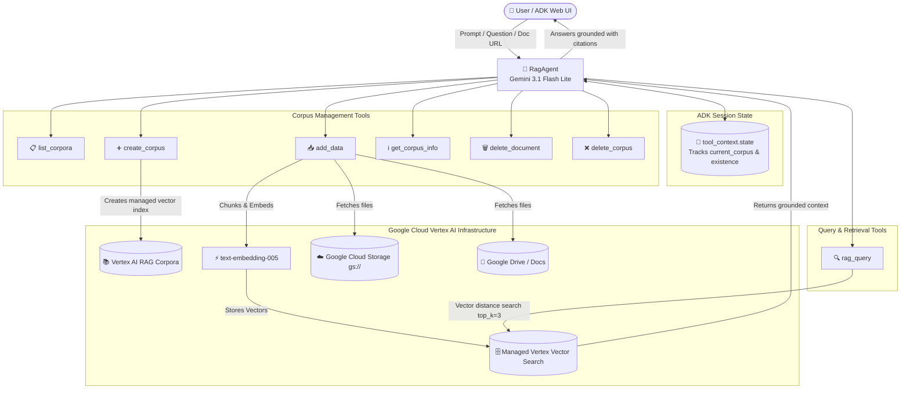

# 🧠 Vertex AI RAG Agent: Architecture, Tool Execution & GCP Setup Guide

This document provides a comprehensive technical guide for the **Vertex AI RAG Agent** (`RagAgent`) built on the **Google Agent Development Kit (ADK)**. It explains the system architecture, how each tool operates under the hood, and the exact step-by-step Google Cloud Platform (GCP) configurations required to run the agent in your GCP account.

---

## 1. System Architecture & Workflow

The RAG Agent integrates Google ADK with **Google Cloud Vertex AI RAG Engine** and **Vertex AI Vector Search**. It acts as an autonomous assistant capable of creating managed vector indices, ingesting documents (from Google Drive or Cloud Storage), querying relevant passages using semantic similarity, and managing corpora lifecycles.



---

## 2. Tools Breakdown: How Each Tool Works

The agent is equipped with **7 specialized tools** backed by `vertexai.preview.rag` and `vertexai.rag`:

### 1. `list_corpora` ([`tools/list_corpora.py`](file:///Users/sachinmishra/Desktop/Agent_Development_Kit/rag_agent/tools/list_corpora.py))
* **Purpose**: Discovers and enumerates all Vertex AI RAG corpora in the configured GCP project and region.
* **How it works**: Calls `rag.list_corpora()` and formats the output into clean dictionaries containing `resource_name` (canonical URI: `projects/{project}/locations/{location}/ragCorpora/{id}`), `display_name`, and timestamp metadata.
* **Why it matters**: The canonical `resource_name` is used by the agent internally to ensure reliable execution with all other tools.

### 2. `create_corpus` ([`tools/create_corpus.py`](file:///Users/sachinmishra/Desktop/Agent_Development_Kit/rag_agent/tools/create_corpus.py))
* **Purpose**: Provisions a brand-new managed RAG corpus in Vertex AI.
* **How it works**:
  1. Sanitizes the user-specified corpus name.
  2. Sets the publisher embedding model to `text-embedding-005`.
  3. Provisions a backend vector store using Google Cloud's fully-managed database tier (`RagManagedDb`), avoiding the serverless indexing project capacity bottleneck that can occur with `RagManagedVertexVectorSearch` in high-traffic regions like `us-central1`.
  4. Automatically records the new corpus in the session state (`tool_context.state["current_corpus"] = corpus_name`), setting it as active for immediate querying or data addition.

### 3. `add_data` ([`tools/add_data.py`](file:///Users/sachinmishra/Desktop/Agent_Development_Kit/rag_agent/tools/add_data.py))
* **Purpose**: Ingests files into the vector database.
* **Supported Sources**:
  - Google Drive files: `https://drive.google.com/file/d/{FILE_ID}/view`
  - Google Docs / Sheets / Slides (auto-normalized to Drive format)
  - Google Cloud Storage: `gs://{bucket}/{path}`
* **How it works**:
  1. Validates and converts native Google Docs/Sheets URLs into standard Drive file view URIs.
  2. Configures semantic chunking: `chunk_size=512` characters with `chunk_overlap=100` characters (`TransformationConfig`).
  3. Calls `rag.import_files(...)` with a rate limit guard (`max_embedding_requests_per_min=1000`).
  4. Vertex AI automatically parses the document, creates chunks, calls the embedding model, and indexes the vectors.

### 4. `rag_query` ([`tools/rag_query.py`](file:///Users/sachinmishra/Desktop/Agent_Development_Kit/rag_agent/tools/rag_query.py))
* **Purpose**: Performs semantic retrieval to answer user questions using grounded knowledge.
* **How it works**:
  1. Resolves the target corpus from user input or retrieves `tool_context.state["current_corpus"]`.
  2. Sets retrieval parameters: `top_k=3` and `vector_distance_threshold=0.5`.
  3. Calls `rag.retrieval_query(...)`. Vertex AI encodes the query into an embedding vector, performs approximate nearest neighbor (ANN) search in Vector Search, and filters out results whose vector distance exceeds `0.5`.
  4. Returns the top matching text snippets, similarity scores, source file names, and source URIs to the agent, which synthesizes a natural, cited response.

### 5. `get_corpus_info` ([`tools/get_corpus_info.py`](file:///Users/sachinmishra/Desktop/Agent_Development_Kit/rag_agent/tools/get_corpus_info.py))
* **Purpose**: Inspects the contents and files within an existing corpus.
* **How it works**: Resolves the corpus resource name and invokes `rag.list_files(corpus_resource_name)`. Extracts individual `file_id`, `display_name`, `source_uri`, and creation/update timestamps.

### 6. `delete_document` ([`tools/delete_document.py`](file:///Users/sachinmishra/Desktop/Agent_Development_Kit/rag_agent/tools/delete_document.py))
* **Purpose**: Removes an individual document from an indexed corpus without deleting the entire corpus.
* **How it works**: Uses `rag.delete_file(f"{corpus_resource_name}/ragFiles/{document_id}")` to remove the document and its associated vector chunks.

### 7. `delete_corpus` ([`tools/delete_corpus.py`](file:///Users/sachinmishra/Desktop/Agent_Development_Kit/rag_agent/tools/delete_corpus.py))
* **Purpose**: Deletes an entire corpus and all associated embeddings, files, and vector indices.
* **Safety Mechanism**: Requires an explicit `confirm=True` parameter to prevent accidental deletion. Updates session state to invalidate cached existence flags.

---

## 3. Session State & Auto-Resolution (`tools/utils.py`)

To ensure a smooth conversational experience where the user doesn't need to specify full resource strings:
* **Current Corpus Tracking**: Once a corpus is created or queried, `tool_context.state["current_corpus"]` stores its name. Subsequent commands (e.g. *"add this file"*, *"what does it say about X?"*) automatically target that active corpus.
* **Display Name Resolution**: The user can refer to a corpus by its simple name (e.g. `hr_docs`), and `get_corpus_resource_name()` dynamically queries Vertex AI to resolve it to the canonical resource name (`projects/12345/locations/us-central1/ragCorpora/67890`).

---

## 4. Google Cloud Platform (GCP) Configuration Checklist

Before running `rag_agent` against your GCP account, complete the following configuration steps:

### Step 1: Select or Create a GCP Project
1. Log in to the [Google Cloud Console](https://console.cloud.google.com/).
2. Create a new project or select an existing one.
3. Note your **Project ID** (e.g. `my-rag-project-12345`) and **Project Number**.

### Step 2: Enable Required GCP APIs
Run the following `gcloud` commands in your terminal to enable the necessary APIs:

```bash
# 1. Enable Vertex AI API
gcloud services enable aiplatform.googleapis.com --project=YOUR_PROJECT_ID

# 2. Enable Vertex AI Vector Search API
gcloud services enable vectorsearch.googleapis.com --project=YOUR_PROJECT_ID

# 3. Enable Cloud Storage API (if ingesting files from GCS buckets)
gcloud services enable storage.googleapis.com --project=YOUR_PROJECT_ID

# 4. Enable Google Drive API (if ingesting files from Google Drive)
gcloud services enable drive.googleapis.com --project=YOUR_PROJECT_ID
```

> [!NOTE]
> `vectorsearch.googleapis.com` is required because `create_corpus` configures `RagManagedVertexVectorSearch()` as the backend vector index.

### Step 3: Configure Region Selection
Vertex AI RAG Engine is a regional service.
> [!IMPORTANT]
> Google Cloud currently enforces an **allowlist restriction** for new projects in `us-central1`, `us-east1`, and `us-east4` (which causes `500 No available indexing project found`).
> Regions with **General Availability / Preview open to all projects without allowlisting**:
> - **`asia-south1`** (Mumbai, India) - **Recommended (lowest latency)**
> - **`europe-west3`** (Frankfurt, Germany) - **Recommended for EU**
> - **`europe-west4`** (Eemshaven, Netherlands)

### Step 4: Configure IAM Roles & Permissions

#### A. For Your User Account / Developer Identity
Ensure your authenticated Google identity has:
* **Vertex AI User** (`roles/aiplatform.user`) or **Vertex AI Administrator** (`roles/aiplatform.admin`)
* **Storage Object Viewer** (`roles/storage.objectViewer`) *(if reading files from GCS)*

```bash
gcloud projects add-iam-policy-binding YOUR_PROJECT_ID \
    --member="user:your-email@example.com" \
    --role="roles/aiplatform.user"
```

#### B. For the Vertex AI Service Agent (Crucial for Data Ingestion)
When you call `add_data`, Vertex AI's managed backend service agent performs the ingestion on your behalf.
The service agent has the format:
```
service-{PROJECT_NUMBER}@gcp-sa-aiplatform.iam.gserviceaccount.com
```

* **If ingesting from Google Cloud Storage (`gs://my-bucket/docs/`)**:
  Grant the Vertex AI Service Agent read access to your bucket:
  ```bash
  gsutil iam ch \
      serviceAccount:service-YOUR_PROJECT_NUMBER@gcp-sa-aiplatform.iam.gserviceaccount.com:objectViewer \
      gs://YOUR_BUCKET_NAME
  ```
* **If ingesting from Google Drive**:
  In Google Drive, open the file or folder, click **Share**, and share it with `service-YOUR_PROJECT_NUMBER@gcp-sa-aiplatform.iam.gserviceaccount.com` with **Viewer** access.

### Step 5: Local Authentication (Application Default Credentials)
Authenticate your local environment with GCP:

```bash
# 1. Log in to gcloud CLI
gcloud auth login

# 2. Generate Application Default Credentials (ADC) used by vertexai.init()
gcloud auth application-default login

# 3. Set the default project
gcloud config set project YOUR_PROJECT_ID
```

### Step 6: Configure Project Environment Variables (`.env`)
In the root directory of this repository (`Agent_Development_Kit/.env`), configure:

```bash
# GCP Project ID
GOOGLE_CLOUD_PROJECT=your-gcp-project-id

# Vertex AI RAG Region (e.g., us-central1)
GOOGLE_CLOUD_LOCATION=us-central1

# Google Gemini API key (for Gemini 3.1 Flash Lite model inference in ADK)
GOOGLE_API_KEY=your-gemini-api-key
```

---

## 5. How to Run & Test the RAG Agent

Launch the agent with the Google ADK Web UI:

```bash
adk web rag_agent
```

### Example Multi-Turn Conversation:

1. **Create a Corpus**:
   > *"Create a new corpus named company_policies"*
   - The agent calls `create_corpus(corpus_name='company_policies')`.

2. **Add Data**:
   > *"Add this document to the corpus: https://drive.google.com/file/d/1A2B3C.../view"*
   - The agent converts the URL and calls `add_data(corpus_name='company_policies', paths=[...])`.

3. **Query Grounded Information**:
   > *"What is the remote work reimbursement policy according to the document?"*
   - The agent calls `rag_query(corpus_name='company_policies', query='remote work reimbursement policy')`.
   - The agent retrieves the top matching vector chunks and synthesizes an answer with citations.

4. **Corpus Management**:
   > *"List all my corpora and show me the files in company_policies"*
   - The agent calls `list_corpora()` followed by `get_corpus_info(corpus_name='company_policies')`.
